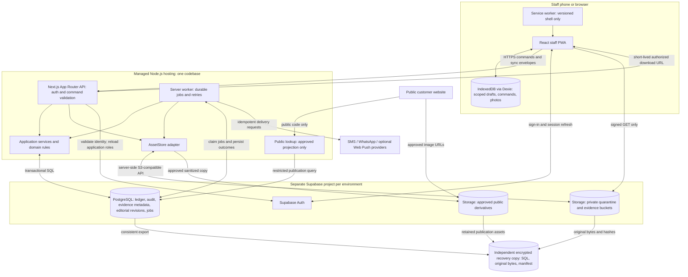

# Architecture diagram

Status: authoritative extracted specification; target behavior, not implementation evidence.
Source: [docs/architecture-technical-spec.md — Architecture diagram](../../architecture-technical-spec.md#architecture-diagram)

<!-- requirement:ARC-01-01 -->

<!-- /requirement:ARC-01-01 -->

<!-- requirement:ARC-01-02 -->
The browser service worker and the server worker have separate responsibilities. The service worker never
commits business decisions. Browser clients do not write operational database tables or carry S3 credentials.
The public lookup path cannot query private source/evidence tables. Diagram arrows describe application
interfaces, not permission to bypass authorization.
<!-- /requirement:ARC-01-02 -->
