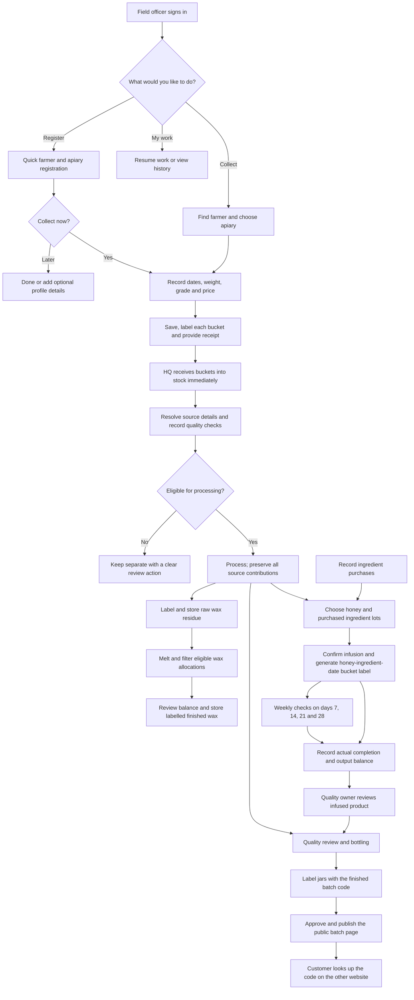

# 1. End-to-end flow

Status: authoritative extracted specification; target behavior, not implementation evidence.
Source: [docs/mobile-first-workflow-ui-plan.md — 1. End-to-end flow](../../mobile-first-workflow-ui-plan.md#1-end-to-end-flow)

<!-- requirement:WF-03-01 -->

<!-- /requirement:WF-03-01 -->

<!-- requirement:WF-03-02 -->
Collections can happen at an apiary or a collection centre. Record both the
**source apiary** and the **receiving place**; a collection centre never replaces
the source. One farmer may have several apiaries, one collection may fill several
buckets, and one finished batch may contain several source lots.
<!-- /requirement:WF-03-02 -->
