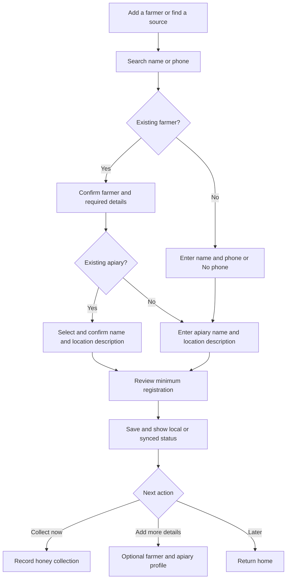

# Ready to collect

Status: authoritative extracted specification; target behavior, not implementation evidence.
Source: [docs/mobile-first-workflow-ui-plan.md — Ready to collect](../../mobile-first-workflow-ui-plan.md#ready-to-collect)

<!-- requirement:WF-05-01 -->
Registration has three short steps:
<!-- /requirement:WF-05-01 -->

<!-- requirement:WF-05-02 -->
1. **Farmer:** enter name and either a phone number or an explicit **No phone**.
<!-- /requirement:WF-05-02 -->

<!-- requirement:WF-05-03 -->
2. **Apiary:** enter its name and a location description, linked to this farmer.
<!-- /requirement:WF-05-03 -->

<!-- requirement:WF-05-04 -->
3. **Review:** confirm the farmer and apiary, then **Save and record collection**
   or **Save and finish**.
<!-- /requirement:WF-05-04 -->

<!-- requirement:WF-05-05 -->
These fields are the minimum for field capture. Missing optional profile details
do not block a collection. An incomplete minimum registration stays a resumable
draft and identifies the missing field. Local readiness permits offline capture;
it does not imply server acceptance, completed source reconciliation or quality
release.
<!-- /requirement:WF-05-05 -->

<!-- requirement:WF-05-06 -->

<!-- /requirement:WF-05-06 -->

<!-- requirement:WF-05-07 -->
Search only authorized records. Offline, say **Searching records on this device**.
A possible duplicate requires a deliberate choice; uncertain matches go to the
supervisor. Preserve any linked field drafts while that review is pending.
<!-- /requirement:WF-05-07 -->
