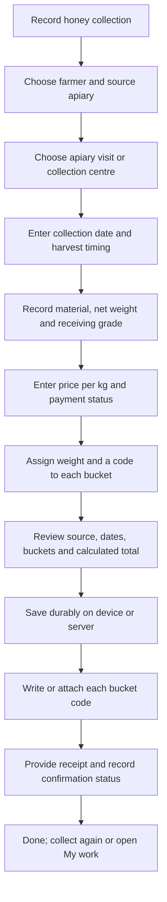

# 3. Collection, dates, payment and bucket labels

Status: authoritative extracted specification; target behavior, not implementation evidence.
Source: [docs/mobile-first-workflow-ui-plan.md — 3. Collection, dates, payment and bucket labels](../../mobile-first-workflow-ui-plan.md#3-collection-dates-payment-and-bucket-labels)

<!-- requirement:WF-07-01 -->

<!-- /requirement:WF-07-01 -->
