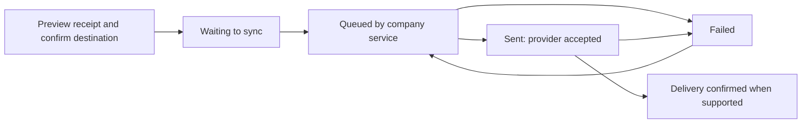

# Company receipt delivery

Status: authoritative extracted specification; target behavior, not implementation evidence.
Source: [docs/mobile-first-workflow-ui-plan.md — Company receipt delivery](../../mobile-first-workflow-ui-plan.md#company-receipt-delivery)

<!-- requirement:WF-11-01 -->
SMS and WhatsApp join paper, print and shown-on-phone options. Preview the receipt
and confirm the destination before saving the send request. Default to the farmer's
contact number, **never** the mobile-money number. When the farmer has no contact
number, require an entered and farmer-approved alternative recipient. Keep contact,
payment-account and delivery identities separate and private.
<!-- /requirement:WF-11-01 -->

<!-- requirement:WF-11-02 -->

<!-- /requirement:WF-11-02 -->

<!-- requirement:WF-11-03 -->
The company service owns sending, provider callbacks and retry. Retain receipt
identity and immutable content/revision, channel, approved recipient, request ID,
provider IDs, status history, attempts and timestamps. Retry the same receipt and
request; do not duplicate receipts or payments. Deduplicate callbacks and reconcile
uncertain provider outcomes before retrying a send. Destination or channel changes
require an explicit reviewed delivery request; retain earlier attempts. Do not claim
delivery merely because the provider accepted a message. Farmer confirmation,
unavailable response and disputes are recorded independently of delivery.
<!-- /requirement:WF-11-03 -->
