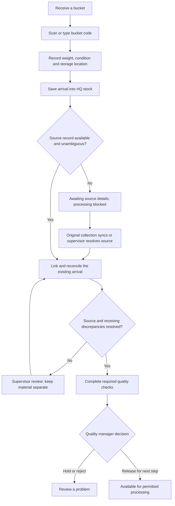

# Arrival is always recorded first

Status: authoritative extracted specification; target behavior, not implementation evidence.
Source: [docs/mobile-first-workflow-ui-plan.md — Arrival is always recorded first](../../mobile-first-workflow-ui-plan.md#arrival-is-always-recorded-first)

<!-- requirement:WF-13-01 -->
HQ staff scan or type the bucket code, record arrival time, condition, received
weight and storage location, then **Save arrival**. Every arrival is immediately
visible in HQ stock, including buckets awaiting source details or quality checks.
The physical arrival does not create another farmer purchase or an extra copy of
the material. Where a source record already exists, receiving records its move
into HQ custody.
<!-- /requirement:WF-13-01 -->

<!-- requirement:WF-13-02 -->

<!-- /requirement:WF-13-02 -->

<!-- requirement:WF-13-03 -->
An unknown code may mean an unsynced collection, a typing mistake or an ambiguous
label. Show **Check the code** and, if still unresolved, **Save awaiting source
details**. Do not invent a farmer or apiary to complete the form. Give the arrival
its own stable ID and retain the supplied code and any supporting receipt
reference for later reconciliation.
<!-- /requirement:WF-13-03 -->

<!-- requirement:WF-13-04 -->
When the original record arrives, match using its registered bucket identity and
code. Link the existing arrival; do not insert a second arrival or count the
weight twice. Safe, unambiguous matches can be linked by the system; inconsistent
sources, repeated receipts, duplicate codes or weight discrepancies require
review. Preserve both collection and received weights and record any approved
adjustment explicitly. Source resolution never clears an independent quality
hold or automatically releases stock.
<!-- /requirement:WF-13-04 -->

<!-- requirement:WF-13-05 -->
Quality observations can be captured while source details are pending, but
processing remains blocked until source reconciliation and all relevant release
conditions are satisfied. If the source never becomes available, a supervisor
investigates; the quality manager controls the resulting disposition.
<!-- /requirement:WF-13-05 -->
