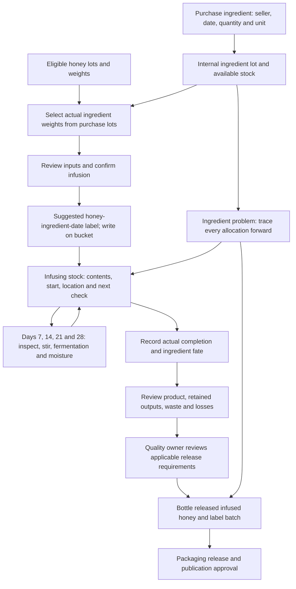

# Ingredient purchase lots and bulk infusion

Status: authoritative extracted specification; target behavior, not implementation evidence.
Source: [docs/mobile-first-workflow-ui-plan.md — Ingredient purchase lots and bulk infusion](../../mobile-first-workflow-ui-plan.md#ingredient-purchase-lots-and-bulk-infusion)

<!-- requirement:WF-18-01 -->

<!-- /requirement:WF-18-01 -->

<!-- requirement:WF-18-02 -->
Purchase fields: ingredient, supplier/seller, purchase date, quantity and unit;
optional supplier batch and invoice/receipt references. Assign an internal lot
reference even when no supplier batch exists. The initial choices are vanilla,
Scotch bonnet chilli, garlic, rosemary, lemon peel, orange peel and **Other** with
a required name. The reference supports kg and g with explicit mass conversion;
additional units require approved conversion rules, never an assumed weight per
piece or volume. Purchase capture does not imply quality release.
<!-- /requirement:WF-18-02 -->

<!-- requirement:WF-18-03 -->
**103 — Choose honey:** start with one dropdown of available, eligible honey lots,
showing the batch/source and available weight. Enter the weight taken. **Add another
honey batch** adds another dropdown/weight row; rows can be removed. Exclude already
selected lots from other dropdowns and ignore removed rows when allocating stock.
<!-- /requirement:WF-18-03 -->

<!-- requirement:WF-18-04 -->
**104 — Add ingredients:** start with one ingredient-purchase-lot dropdown and its
actual added weight. Single-ingredient infusion is the usual path. Keep an optional
**Add another ingredient** action for exceptions. Only available, released lots are
selectable; preserve partial quantities and unused balances.
<!-- /requirement:WF-18-04 -->

<!-- requirement:WF-18-05 -->
**105 — Start details:** record actual start date/time, operator, facility and storage.
Do not require staff to invent a container label. Review inputs, then confirm their
allocations together. After confirmation, suggest a human-readable label using the
chosen honey, ingredient(s), and the start date **last**, for example:
**Shea Grove honey + River apiary honey · Vanilla · 2026-10-27**. Show the stable
infusion batch/container references separately, and ask staff to copy the details
onto the bucket. Reprints keep the saved description and references.
<!-- /requirement:WF-18-05 -->

<!-- requirement:WF-18-06 -->
Show infusing stock with contents, every source reference, actual start, location,
bucket label and next scheduled check. On **days 7, 14, 21 and 28** after the start,
staff inspect the batch, stir it, check for fermentation and measure moisture.
The weekly cadence was explicitly confirmed by the user on 28 October 2026.
<!-- /requirement:WF-18-06 -->

<!-- requirement:WF-18-07 -->
Each check retains its scheduled date and actual performed date/time separately,
author/operator, inspected confirmation, stirring status, fermentation observations,
moisture percentage, instrument reference and notes. If stirring did not happen,
require an explanation. Fermentation concerns or uncertain observations require
follow-up notes and quality review. Keep every check in the batch/container history;
repeated submission must not duplicate or overwrite it. Extra observations, retests
and authorized corrections must append evidence in production.
<!-- /requirement:WF-18-07 -->

<!-- requirement:WF-18-08 -->
Show scheduled, due, overdue and recorded states. Do not mark planned work done in
advance, infer successful fermentation checks from moisture, or invent moisture
limits. Outstanding checks due before recorded completion and unresolved concerns
block the applicable release until the quality owner has the actual evidence and
an authorized disposition. The schedule is monitoring, not an automatic completion
date or a prescribed minimum/maximum infusion duration.
<!-- /requirement:WF-18-08 -->

<!-- requirement:WF-18-09 -->
Finish explicitly: record actual completion, whether each ingredient remains or
was removed, resulting infused-honey weight, separately retained outputs and
storage, waste, losses and supporting explanation. Review the balance before
creating a distinct infused-honey output. Elapsed time alone never completes or
releases the batch. The quality owner supplies processing and release requirements;
this design specifies no recipes, durations, safety limits or certification claims.
<!-- /requirement:WF-18-09 -->

<!-- requirement:WF-18-10 -->
Bottling requires recorded completion and the applicable quality release. Preserve
all honey and ingredient ancestors through bottling, packaging and publication.
An ingredient issue traces forward to **every** affected infusion, retained output
and bottled batch, including when the ingredient was later removed. The clickable
session contains one sample infusion; production queries the full allocation graph.
<!-- /requirement:WF-18-10 -->
