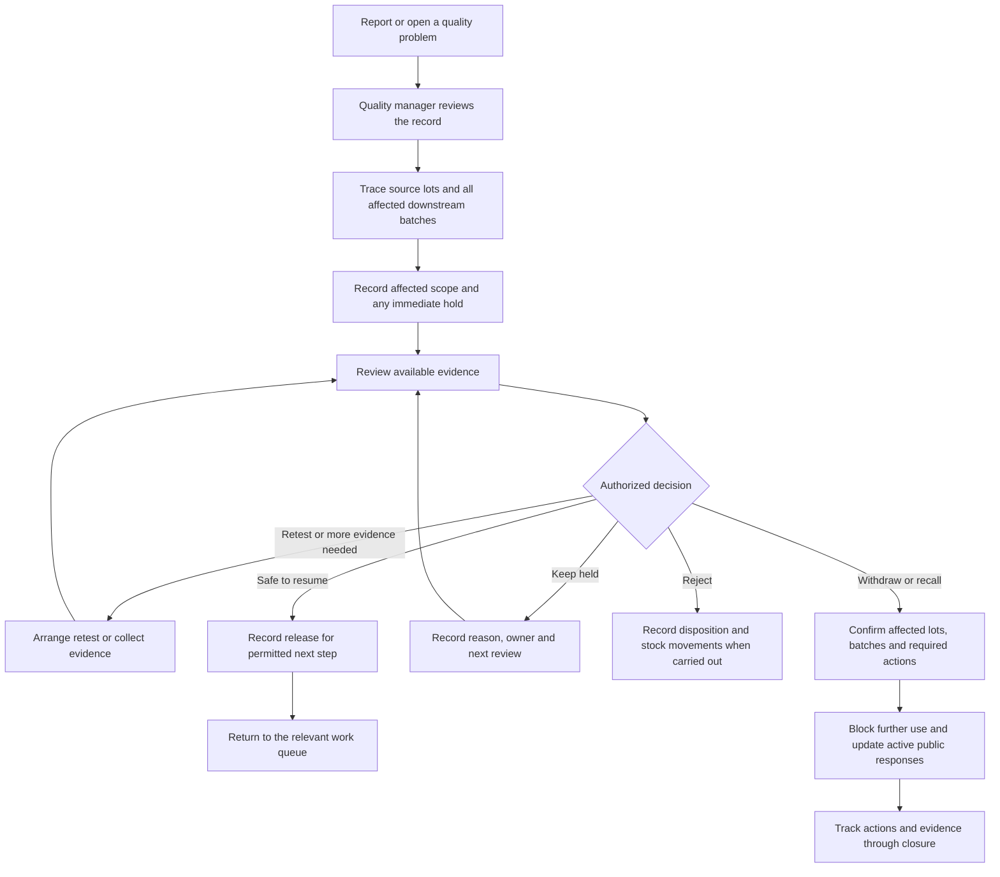

# Review a problem

Status: authoritative extracted specification; target behavior, not implementation evidence.
Source: [docs/mobile-first-workflow-ui-plan.md — Review a problem](../../mobile-first-workflow-ui-plan.md#review-a-problem)

<!-- requirement:WF-19-01 -->
The quality manager owns this workflow whether the issue is found at receiving,
after a retest, during processing or after bottling. Other staff can report a
problem and identify the material; reporting alone does not authorize a quality
disposition. The issue appears prominently in the quality manager's queue.
<!-- /requirement:WF-19-01 -->

<!-- requirement:WF-19-02 -->

<!-- /requirement:WF-19-02 -->

<!-- requirement:WF-19-03 -->
A hold or recall must identify affected downstream lots, packaging runs and
active publications, even if the original material has already been consumed.
The quality manager confirms the action and scope; the system applies the
required restrictions and public-page action consistently. A hold does not
silently imply a public withdrawal; withdrawal/recall follows its explicit
approved public response policy. Failures to apply required actions remain
visible and cannot be reported as complete. An urgent hold, withdrawal or recall
can be authorized using available evidence without waiting for a retest.
<!-- /requirement:WF-19-03 -->

<!-- requirement:WF-19-04 -->
Retesting creates linked evidence; it never overwrites the failed result.
Release requires an authorized recorded decision and cannot bypass another
unresolved source or quality restriction. Rejected/recalled material has no
ordinary **Resume** shortcut; any further action must follow permitted V1
transitions. Preserve publication revisions and the operational audit history.
<!-- /requirement:WF-19-04 -->

<!-- requirement:WF-19-05 -->
The UI must not infer **UNBS certified** from a test or checklist. The quality
owner defines the applicable standards, limits, evidence and release criteria.
This plan settles workflow ownership, not the technical content of those checks.
<!-- /requirement:WF-19-05 -->
