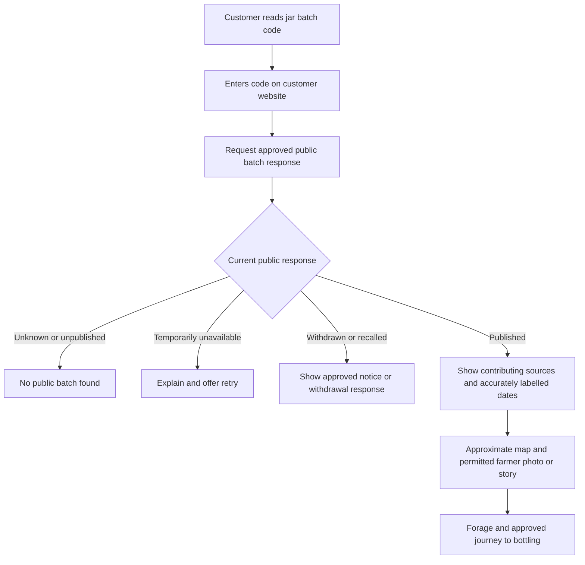

# 6. Customer batch lookup

Status: authoritative extracted specification; target behavior, not implementation evidence.
Source: [docs/mobile-first-workflow-ui-plan.md — 6. Customer batch lookup](../../mobile-first-workflow-ui-plan.md#6-customer-batch-lookup)

<!-- requirement:WF-20-01 -->

<!-- /requirement:WF-20-01 -->

<!-- requirement:WF-20-02 -->
- The code identifies a batch/lot and can appear on every jar in that batch.
  A blended batch shows all approved contributors or an honest grouped summary,
  preserving collection dates and exact, approximate or unknown harvest timing.
<!-- /requirement:WF-20-02 -->

<!-- requirement:WF-20-03 -->
- The other website consumes a stable read-only public API or links to the
  approved page. It receives an approved projection, not private staff records.
  Withdrawal/recall and permission changes must reach that website and its caches
  according to the agreed publication policy.
<!-- /requirement:WF-20-03 -->

<!-- requirement:WF-20-04 -->
- Farmer photo and story publication is separately opt-in and reviewed. Missing
  photos, a declined permission or an incomplete optional profile does not block
  an otherwise eligible traceability page; use the approved source summary and
  omit unapproved content. Record permission before publishing any profile data.
<!-- /requirement:WF-20-04 -->

<!-- requirement:WF-20-05 -->
- Exact operational GPS coordinates remain private. Publish only an approved
  approximate source area, with a text alternative if the map is unavailable.
  Do not send exact coordinates to the public map provider or browser.
<!-- /requirement:WF-20-05 -->

<!-- requirement:WF-20-06 -->
- Exclude national identifiers, phone/mobile money numbers, registered holder names,
  receipt destinations, ingredient suppliers, invoices, purchase details and private notes.
  Keep historical public revisions privately for audit while updating the active
  response when permission or publication status changes.
<!-- /requirement:WF-20-06 -->

<!-- requirement:WF-20-07 -->
Infused products are identified distinctly from plain honey. Show the approved
honey sources, farmer stories, forage and accurately labelled dates, plus all
ingredients used in the actual batch. Describe ingredients used for infusion and
subsequently removed explicitly. Do not claim an ingredient was grown at its
seller: “Purchased from Ark Organics” records a seller, not vanilla origin. Supplier
names and purchase evidence remain internal by default.
<!-- /requirement:WF-20-07 -->
