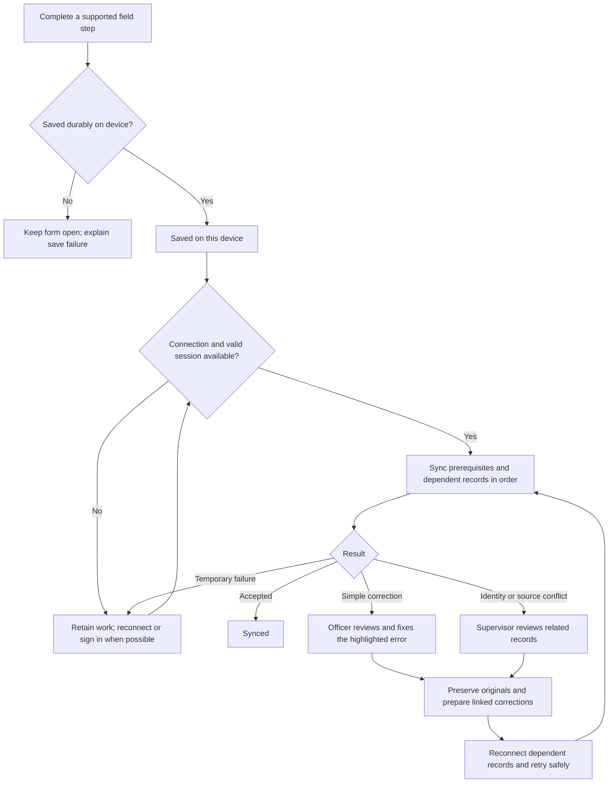

# 7. Poor connection and guided correction

Status: authoritative extracted specification; target behavior, not implementation evidence.
Source: [docs/mobile-first-workflow-ui-plan.md — 7. Poor connection and guided correction](../../mobile-first-workflow-ui-plan.md#7-poor-connection-and-guided-correction)

<!-- requirement:WF-21-01 -->
Online sign-in prepares an authorized offline session. Before a field trip, make
the app and minimum permitted reference records available on the device. Field
capture uses the approved V1 offline commands; HQ, privileged quality and
publication actions require an online server decision.
<!-- /requirement:WF-21-01 -->

<!-- requirement:WF-21-02 -->

<!-- /requirement:WF-21-02 -->
